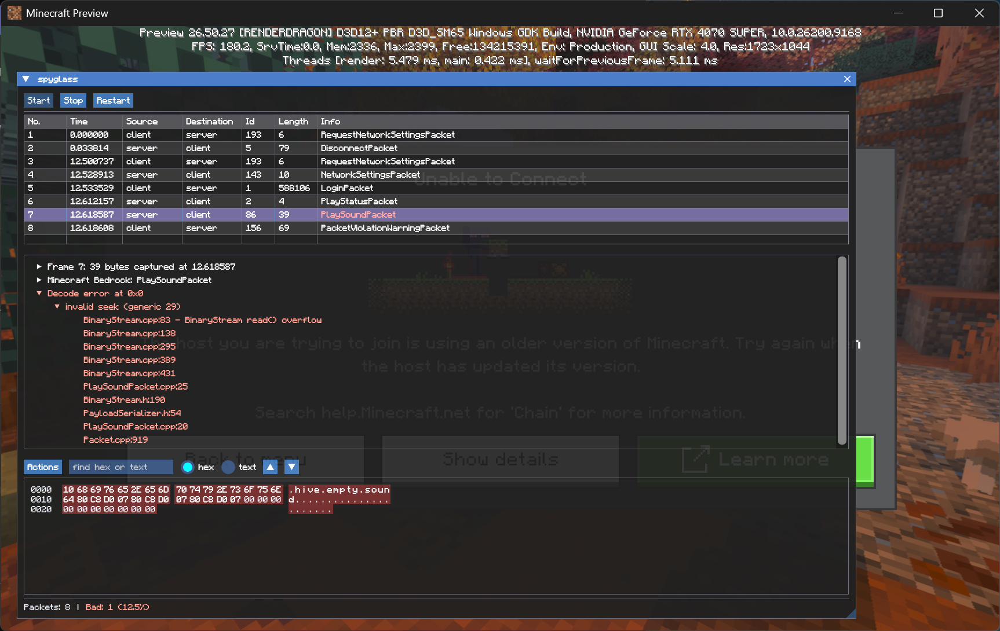
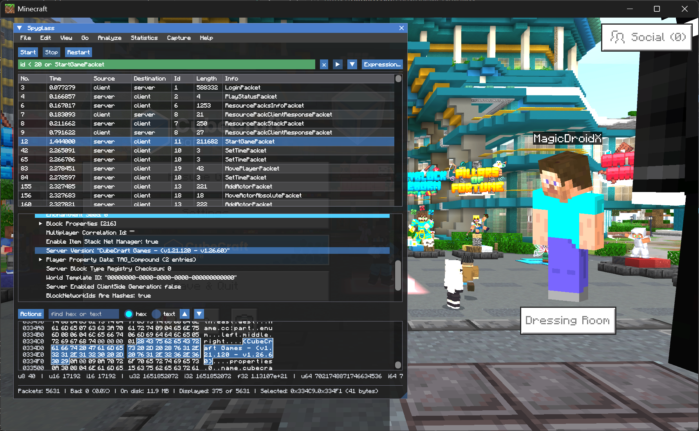

<div align="center">
  

<h3>Spyglass</h3>

<p>
  <b>A packet capture that runs inside the Minecraft: Bedrock client</b><br>
  Every packet the client sends and receives, and the reason it rejected the ones it could not read
</p>

[](https://github.com/EndstoneMC/spyglass/actions/workflows/ci.yml)
[-black)](https://www.minecraft.net/en-us/download)
[](LICENSE)
[](https://discord.gg/xxgPuc2XN9)

</div>



## Why Spyglass?

If you write server software, a proxy or a protocol translator, a packet the client cannot read usually shows up as a
dropped connection or a world that looks wrong. Spyglass runs inside the client and shows you the packet, how far the
client read into it, and the error it raised.

## Features

The overlay is laid out like Wireshark, with three panes:

- **Packet list.** Every packet of the session with its direction, id, length and name. Failed decodes are coloured,
  and the list follows the newest packet until you scroll up.
- **Details.** The packet's decoded fields, with the names and enum values the client itself uses. NBT opens as a tag
  tree. For a failed decode you also get the client's error, the fields it read before it stopped, and the call stack
  down to file and line.
- **Bytes.** The packet body in hex, with the part the client never read tinted. Search it with `Ctrl+F` and `F3`, and
  copy a selection as a hex dump, a hex stream, text, a C array or base64.



`Filter` on the toolbar lists every packet id the client knows, with a tick box and a count for each. Untick an id to
hide it, or show only failed decodes or one direction. Right-click a packet in the list to hide it or show only it.

`Start`, `Stop` and `Restart` control the capture. A capture has no length limit, and Spyglass deletes it when the
client closes. `Capture` ▸ `Options` sets how much memory it uses and can turn off capturing sent packets. The status
bar shows the packet count, the share that failed, the size of the capture and any dropped packets.

The menus hold everything else:

- `Go` jumps to a packet by number, to the next failed decode or to the next packet of the same kind, and back and
  forward through the packets you viewed.
- `Edit` finds packets by name, id, or hex or text in the body. It also marks packets, sets the zero of the `Time`
  column, and copies rows or the details tree as text or CSV.
- `View` hides panes, zooms, opens a packet in its own window, and sets what the `Time` column shows.
- `Analyze` groups failed decodes by error and packet, and reads the selected bytes as an integer, a float, a varint
  and text.
- `Statistics` shows a breakdown per packet id, the distribution of packet lengths and a graph of packets or bytes per
  second.
- `File` exports packets as text, CSV or JSON, the selected bytes as a raw file, or a session summary. The save dialog
  starts in `%LOCALAPPDATA%\spyglass`, or `~/.local/share/spyglass` on Linux.

## Quick Start

### Windows

1. Download `spyglass-vX.Y.Z-windows-x64.zip` from the [releases](https://github.com/EndstoneMC/spyglass/releases) and
   unpack it.
2. Start Minecraft.
3. Run `spyglass.exe` from the unpacked folder. It asks for administrator rights and continues in a new window.
4. Press **F12** in game to open the overlay.

The zip holds one DLL per client version, and `spyglass.exe` loads the one that matches the running client.

| Option | Description |
| --- | --- |
| `--dll <path>` | Load this DLL instead of the one that matches the client. |
| `--process <name>` | Inject into a process other than `Minecraft.Windows.exe`. |

The overlay takes the mouse only while the cursor is visible and over the overlay, so you can leave it open while you
play.

### Linux

On Linux, Spyglass is a mod for the [Minecraft Bedrock Launcher](https://github.com/minecraft-linux/mcpelauncher-manifest).

1. Download `spyglass-vX.Y.Z-linux-x64.zip` from the [releases](https://github.com/EndstoneMC/spyglass/releases) and
   unpack it. It holds one mod folder per client version.
2. Copy the folder for the client your launcher runs into the launcher's mods directory:

   ```shell
   mkdir -p ~/.local/share/mcpelauncher/mods/spyglass/0.3.4
   cp -r spyglass-0.3.4-1.26.40 ~/.local/share/mcpelauncher/mods/spyglass/0.3.4/x86_64
   ```

3. Add that directory under `Mods` in the profile you play, and start the game.
4. Press **F12** in game to open the overlay.

## Supported Clients

| File | Client |
| --- | --- |
| `spyglass-0.3.4-1.26.50.dll` | Windows release 1.26.50.5, 1.26.51.1 |
| `spyglass-0.3.4-1.26.60.dll` | Windows release 1.26.60.5 |
| `spyglass-0.3.4-1.26.70.preview.dll` | Windows preview 1.26.70.21 |
| `libspyglass-0.3.4-1.26.40.so` | Android x86_64 1.26.4x, for the Linux launcher |

A payload loaded into a client it was not built for installs nothing. If the packet count stays at zero while you are
connected, open the errors window under `Help` to see why. A client update can break a payload until a new release
supports it.

## Building from Source

Both platforms build with CMake presets, and the configure step fetches every dependency.

### Windows

You need clang-cl and lld-link from LLVM 18 or newer (the "C++ Clang tools for Windows" component of Visual Studio),
the MSVC build tools for the Windows SDK and STL, CMake 3.28 or newer, and Ninja. Run these from a Developer prompt:

```shell
cmake --preset relwithdebinfo-windows
cmake --build --preset relwithdebinfo-windows
```

`spyglass.exe` and the DLLs land in `build/relwithdebinfo-windows`. `spyglass.exe` also picks up a DLL you build for
another client if you put it in the same folder.

### Linux launcher mod

The mod is an Android x86_64 shared object. You need the Android NDK with `ANDROID_NDK_ROOT` set, CMake 3.28 or newer,
and Ninja:

```shell
cmake --preset relwithdebinfo-android
cmake --build --preset relwithdebinfo-android
```

The mod folders land in `build/relwithdebinfo-android`. The `release-windows`, `release-android` and `debug-android`
presets work the same way.

### Other clients

A build produces the payloads a release ships. To build for other clients, set `MINECRAFT_CLIENTS`. Write a release
client as three version parts and a preview client as four:

```shell
cmake --preset relwithdebinfo-windows -D MINECRAFT_CLIENTS="1.26.60;1.26.70.21"
```

The build fails for a client version Spyglass has no patterns for.

## Limitations

- On Windows the overlay draws over Direct3D 11 and 12 only.
- On Linux the overlay uses the launcher's own ImGui. It does not appear on a stripped launcher, or on one built
  against a different ImGui revision.
- The error for a failed decode is whatever the client reports, and some packets report little.
- Call stack frames from a source file added in a client update show as `<hash>:line` until Spyglass adds the file.
- A capture holds everything you and the server sent, including your login. An export writes it to disk unchanged, so
  check a file before you share it.

## License

MIT, see [LICENSE](LICENSE).
